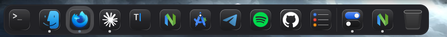
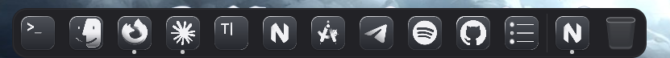
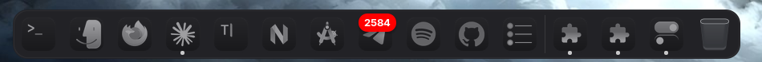
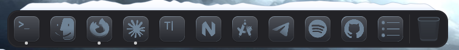
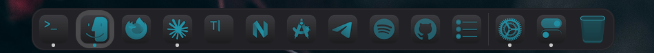
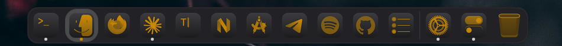
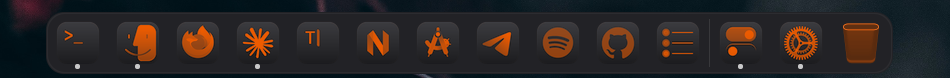
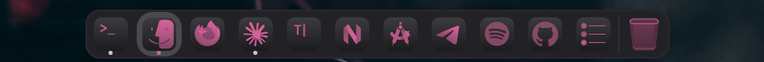
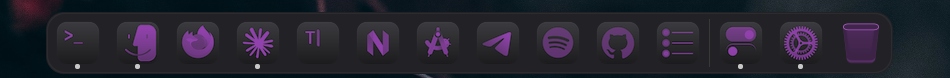

# Tahoe Icons

Twelve macOS Tahoe–style icon themes for Linux (GNOME), built from the **MacOS-Like-Dark** icon theme of
[xnoviiq/MacOS-26-Gnome](https://github.com/xnoviiq/MacOS-26-Gnome), which is based on MacTahoe / WhiteSur.

| Theme | Look |
|---|---|
| **Tahoe Default** | Colourful macOS Tahoe app icons in dark mode — dark tiles, colourful glyphs — with WhiteSur folders |
| **Tahoe White** | Dark monochrome: dark glass tiles, white glyphs (like macOS Tahoe's dark "tinted" icons) |
| **Tahoe Black** | Near-black tiles (`#1f1f22`) with soft grey glyphs (`#9e9ea1`) — derived from Tahoe White; no recolouring tool support yet |
| **Tahoe Blue Gray** | Dark monochrome with slate-blue `#6f8396` glyphs (formerly "Tahoe Blue") |
| **Tahoe Blue** | Dark monochrome with blue `#3584e4` glyphs |
| **Tahoe Turquoise** | Dark monochrome with turquoise `#2190a4` glyphs |
| **Tahoe Red** | Dark monochrome with red `#e62d42` glyphs |
| **Tahoe Green** | Dark monochrome with green `#3a944a` glyphs |
| **Tahoe Yellow** | Dark monochrome with yellow `#c88800` glyphs |
| **Tahoe Orange** | Dark monochrome with orange `#ed5b00` glyphs |
| **Tahoe Pink** | Dark monochrome with pink `#d56199` glyphs |
| **Tahoe Purple** | Dark monochrome with purple `#9141ac` glyphs |

## Screenshots

**Tahoe Default**



**Tahoe White**



**Tahoe Black**



**Tahoe Blue Gray**



**Tahoe Blue**


**Tahoe Turquoise**



**Tahoe Green**


**Tahoe Yellow**



**Tahoe Orange**



**Tahoe Red**


**Tahoe Pink**



**Tahoe Purple**



## Install

```bash
git clone git@github.com:r3nhick/tahoe-icons.git
cd tahoe-icons
./install.sh
gsettings set org.gnome.desktop.interface icon-theme 'Tahoe-Default'   # or Tahoe-White / Tahoe-Blue / Tahoe-Red / Tahoe-Green
```

Log out and back in (Wayland) so GNOME Shell and the dock pick up the new icons.

### Requirements

Nothing else: **Tahoe Default** is a complete theme (≈12,000 icons: apps, actions, status, devices, mimes,
places…), and **all the monochrome themes (White, Black, Blue Gray, Blue, Turquoise, Green, Yellow, Orange, Red, Pink, Purple)** take every icon they don't recolour from Tahoe Default — so install
them all (`install.sh` does). Anything missing falls back to MacTahoe-dark (if installed), Adwaita and hicolor.

## What's inside

- **Tahoe Default** – the full colourful set in dark mode: every app icon's light or coloured tile replaced by a
  dark one with the glyph kept in colour (pre-rendered PNG, 16–512 px), plus actions, status, devices, mime types
  and WhiteSur folders; custom icons for Claude, Discord, Firefox, GitHub, Liner, Motrix, Obsidian, Spotify and Telegram.
- **all the monochrome themes (White, Black, Blue Gray, Blue, Turquoise, Green, Yellow, Orange, Red, Pink, Purple)** – the same app icons recoloured to dark monochrome (glyph in the theme colour
  on a dark tile), plus folders and trash. All of them are
  pre-rendered as PNG at 16, 24, 32, 48, 64, 96, 128 and 256 px, so they stay pixel-sharp in the dock and
  don't use SVG filters (which crash GTK 4.24's SVG renderer). All app-id aliases
  (`org.telegram.desktop`, `com.spotify.Client`, …) are kept as symlinks.

## Coverage

All themes carry exactly the same icon names — **6,528** app names (about 1,480 icons plus aliases) — so no app
falls through to a coloured icon of another theme. That includes every app name of
[WhiteSur](https://github.com/vinceliuice/WhiteSur-icon-theme) (6,473 names: 1,446 icons + 5,027 aliases) and of
MacTahoe, plus Flatpak apps such as Sober, Vesktop, Spot, Extension Manager, GitHub Desktop and Desktop Icons.

### Apps that are not in the pack

New Flatpaks, AppImages and custom `.desktop` files keep their own colourful icon until they get one. `tools/tahoe-icons`
makes it: it takes the app's own icon and writes the dark Default version, and the four coloured versions into `~/.icons`.

```bash
bash tools/install-tools.sh     # installs it plus a user service that runs after every pacman / Flatpak install
tahoe-icons list                # which installed apps are missing
tahoe-icons update              # make them now
tahoe-icons update NAME         # remake one icon, e.g. org.vinegarhq.Sober
```

Needs `python-numpy python-pillow librsvg`.

## Credits & licence

- **[xnoviiq/MacOS-26-Gnome](https://github.com/xnoviiq/MacOS-26-Gnome)** by xnoviq — the *MacOS-Like-Dark* icon theme
  (squircle-wrapped app icons, Dark Launchpad icon) that all the Tahoe themes are made from. MIT licence.
- **[MacTahoe](https://github.com/vinceliuice/MacTahoe-icon-theme)** and
  **[WhiteSur](https://github.com/vinceliuice/WhiteSur-icon-theme)** icon themes by Vince Liuice — the original icons
  and the WhiteSur folders. GNU GPL v3.

Tahoe Icons is distributed under the GNU GPL v3 — see [LICENSE](LICENSE).
