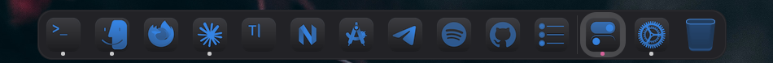

# Tahoe Icons

Five macOS Tahoe–style icon themes for Linux (GNOME), built from the **MacOS-Like-Dark** icon theme of
[xnoviiq/MacOS-26-Gnome](https://github.com/xnoviiq/MacOS-26-Gnome), which is based on MacTahoe / WhiteSur.

| Theme | Look |
|---|---|
| **Tahoe Default** | Colourful macOS Tahoe app icons with WhiteSur folders |
| **Tahoe White** | Dark monochrome: dark glass tiles, white glyphs (like macOS Tahoe's dark "tinted" icons) |
| **Tahoe Blue** | Dark monochrome with slate-blue `#6f8396` glyphs |
| **Tahoe Red** | Dark monochrome with red `#e62d42` glyphs |
| **Tahoe Green** | Dark monochrome with green `#3a944a` glyphs |

## Screenshots

**Tahoe Default**


**Tahoe White**


**Tahoe Blue**



## Install

```bash
git clone git@github.com:r3nhick/tahoe-icons.git
cd tahoe-icons
./install.sh
gsettings set org.gnome.desktop.interface icon-theme 'Tahoe-Default'   # or Tahoe-White / Tahoe-Blue / Tahoe-Red / Tahoe-Green
```

Log out and back in (Wayland) so GNOME Shell and the dock pick up the new icons.

### Requirements

Nothing else: **Tahoe Default** is a complete theme (≈12,000 icons: apps, actions, status, devices, mimes,
places…), and **Tahoe White / Blue / Red / Green** take every icon they don't recolour from Tahoe Default — so install
them all (`install.sh` does). Anything missing falls back to MacTahoe-dark (if installed), Adwaita and hicolor.

## What's inside

- **Tahoe Default** – the full colourful set: ~7,700 app icons plus actions, status, devices, mime types and
  WhiteSur folders; custom icons for Claude, Discord, Firefox, GitHub, Liner, Motrix, Obsidian, Spotify and Telegram.
- **Tahoe White / Blue / Red / Green** – ~1,400 app icons plus folders and trash, recoloured to dark monochrome and
  pre-rendered as PNG at 16, 24, 32, 48, 64, 96, 128 and 256 px, so they stay pixel-sharp in the dock and
  don't use SVG filters (which crash GTK 4.24's SVG renderer). All app-id aliases
  (`org.telegram.desktop`, `com.spotify.Client`, …) are kept as symlinks.

## Credits & licence

- **[xnoviiq/MacOS-26-Gnome](https://github.com/xnoviiq/MacOS-26-Gnome)** by xnoviq — the *MacOS-Like-Dark* icon theme
  (squircle-wrapped app icons, Dark Launchpad icon) that all the Tahoe themes are made from. MIT licence.
- **[MacTahoe](https://github.com/vinceliuice/MacTahoe-icon-theme)** and
  **[WhiteSur](https://github.com/vinceliuice/WhiteSur-icon-theme)** icon themes by Vince Liuice — the original icons
  and the WhiteSur folders. GNU GPL v3.

Tahoe Icons is distributed under the GNU GPL v3 — see [LICENSE](LICENSE).
